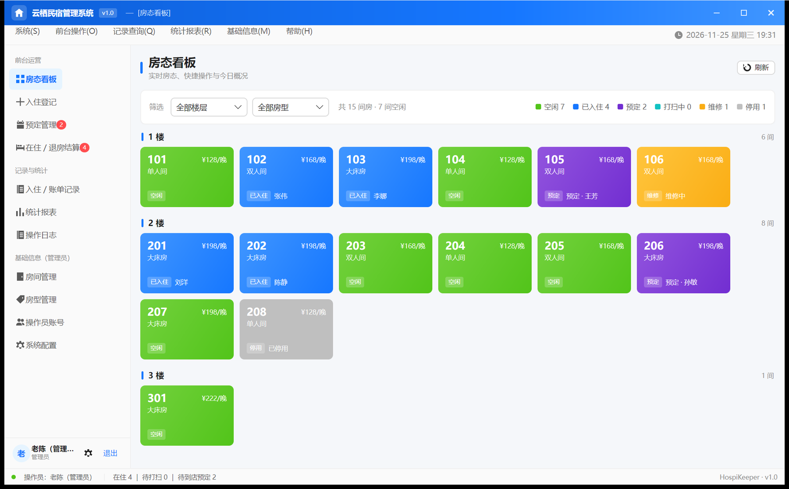
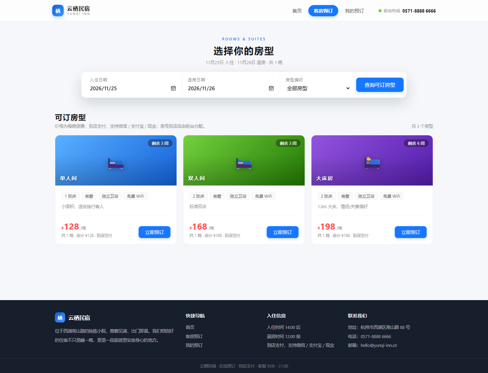
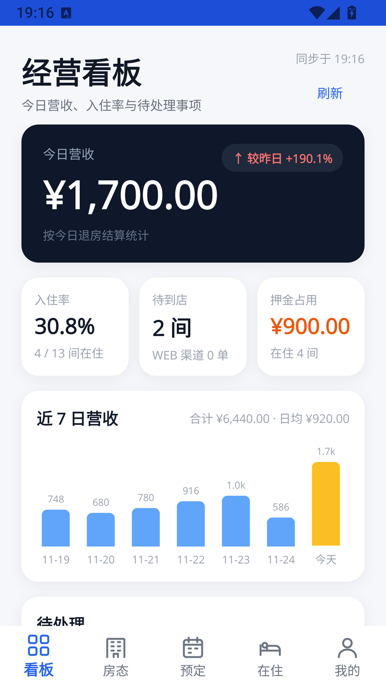
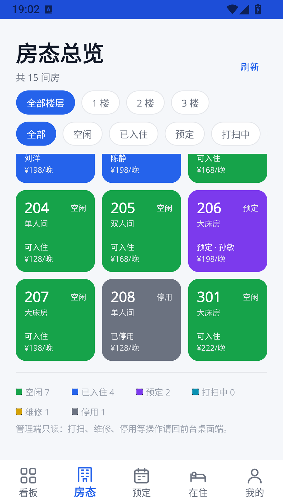
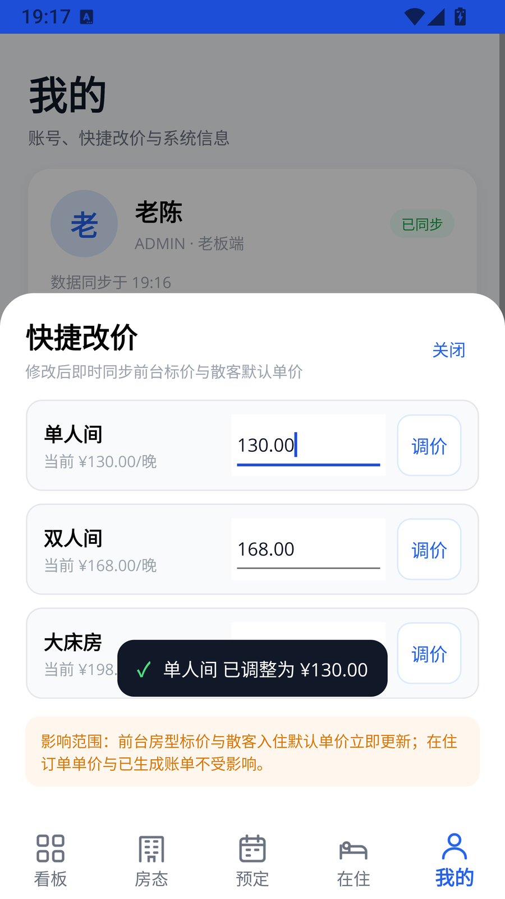

# HospiKeeper · 云栖民宿管理系统

> 一套面向中小型民宿 / 小旅馆的经营系统：桌面端管店内，游客 Web 接预订，Android 管理端随时看经营。
> Avalonia 桌面 + Blazor Server + MAUI Android，共享 ASP.NET Core API 与 MySQL 数据。



## 简介

HospiKeeper 覆盖民宿日常经营的完整闭环：房态看板、入住登记、预定管理、在住与退房结算、账单记录、统计报表、房间 / 房型 / 账号管理。游客可以在线查询房型并提交预订，老板可以通过 Android 管理端查看经营数据、取消预定与快捷改价。

项目同时是一套 .NET 10 全栈技术验证：Avalonia 12 桌面 UI、Blazor Interactive Server、MAUI 原生 XAML、ASP.NET Core 10、EF Core 10、MySQL 8、Redis 与自研共享模块。

## 功能特性

- **房态看板**：六种房态、快捷操作、楼层 / 房型筛选、房态图例与在住信息。
- **前台业务**：入住登记（议价、押金、同住人）、预定转入住、追加消费、损坏扣费、加钟与退房结算。
- **经营报表**：今日指标卡、近 7 日营收、区间营收、房型经营分析。
- **游客预订 Web**：房型日期段实时库存、在线下单、手机号查询与取消，只锁房型不锁房。
- **Android 管理端**：老板看板、只读房态、预定取消、在住查询、快捷改价与操作日志。
- **可复用基础设施**：Ant 风格控件库、Memory / Redis 缓存、Serilog 日志、MySQL 数据库组件。

## 页面预览

| 桌面端 · 房态看板 | 游客 Web · 首页 |
| --- | --- |
|  |  |

| 游客 Web · 客房预订 | Android · 经营看板 |
| --- | --- |
|  |  |

| Android · 房态总览 | Android · 快捷改价 |
| --- | --- |
|  |  |

更多截图见各模块 README。

## 技术栈

| 层 | 技术 |
| --- | --- |
| 运行时 | .NET 10（LTS） |
| 桌面端 | Avalonia 12.2 · CommunityToolkit.Mvvm 8.4 |
| 游客 Web | Blazor Web App · Interactive Server SSR |
| 管理 App | .NET MAUI 10 · Android · 原生 XAML |
| API | ASP.NET Core 10 · Controllers · OpenAPI 3.1 · Scalar |
| 持久化 | EF Core 10 · MySql.EntityFrameworkCore · MySQL 8 |
| 缓存 | `Sylvie233.Caching`：Memory / Redis 可切换 · StackExchange.Redis |
| 日志 | `Sylvie233.Logging`：Serilog 4 · 控制台 + 滚动文件 |
| UI | `Sylvie233.UI`：自研 Ant 风格控件库 |
| 测试 | xUnit · EF Core InMemory（38 个用例） |
| 基础设施 | Docker Compose · MySQL 8 · Redis 7 |

## 快速开始

### 一键启动 API / Web（推荐）

```powershell
pwsh ./manage.ps1 image:up
```

- 游客 Web：<http://localhost:5081>
- API：<http://localhost:5080>
- API 文档：<http://localhost:5080/scalar/v1>

### 本地开发

```bash
# MySQL + Redis
docker compose -f Scripts/docker-compose.yml up -d --wait

# API（首次启动自动迁移数据库并写入演示数据）
dotnet run --project src/HospiKeeper.Api

# 桌面端
dotnet run --project src/HospiKeeper.Desktop

# 游客 Web
dotnet run --project src/HospiKeeper.Web
```

本地开发账号与完整配置见 [API README](src/HospiKeeper.Api/README.md)。

### Android 管理端

```bash
dotnet publish src/HospiKeeper.App/HospiKeeper.App.csproj -f net10.0-android -c Release \
  -p:AndroidKeyStore=false -p:AndroidPackageFormat=apk
adb install -r src/HospiKeeper.App/bin/Release/net10.0-android/publish/com.sylvie233.hospikeeper-Signed.apk
```

APK 默认访问 `http://10.0.2.2:5080`；LDPlayer / 真机可在登录页「服务器 / 修改」切换地址。详见 [App README](src/HospiKeeper.App/README.md)。

## 项目结构

```text
HospiKeeper.slnx
├─ src/
│  ├─ HospiKeeper.Domain          实体 / 枚举 / 计费领域服务
│  ├─ HospiKeeper.Contracts       API DTO 与校验契约
│  ├─ HospiKeeper.Application     用例服务 / 仓储抽象 / 缓存协调
│  ├─ HospiKeeper.Infrastructure  EF Core 持久化 / 迁移 / 种子
│  ├─ HospiKeeper.Api             ASP.NET Core Web API
│  ├─ HospiKeeper.Client          HttpClient API 客户端
│  ├─ HospiKeeper.Desktop         Avalonia 桌面客户端
│  ├─ HospiKeeper.Web             Blazor 游客预订门户
│  ├─ HospiKeeper.App             MAUI Android 管理端
│  ├─ Sylvie233.UI                Ant 风格设计系统
│  ├─ Sylvie233.Caching           缓存端口与实现
│  ├─ Sylvie233.Logging           Serilog 统一日志
│  └─ Sylvie233.Database          MySQL 连接 / 注册 / 迁移执行
├─ tests/HospiKeeper.Tests        xUnit 业务测试
├─ Docs/                          设计文档、原型、数据库参考、截图
├─ Scripts/                       Docker Compose
└─ manage.ps1                     本地运维入口
```

## 模块文档

| 模块 | 文档 |
| --- | --- |
| API / 架构 / 配置 | [src/HospiKeeper.Api/README.md](src/HospiKeeper.Api/README.md) |
| 桌面端 | [src/HospiKeeper.Desktop/README.md](src/HospiKeeper.Desktop/README.md) |
| 游客预订 Web | [src/HospiKeeper.Web/README.md](src/HospiKeeper.Web/README.md) |
| Android 管理端 | [src/HospiKeeper.App/README.md](src/HospiKeeper.App/README.md) |
| 自研 UI 控件库 | [src/Sylvie233.UI/README.md](src/Sylvie233.UI/README.md) |
| EF Core 持久化 | [src/HospiKeeper.Infrastructure/README.md](src/HospiKeeper.Infrastructure/README.md) |
| 缓存模块 | [src/Sylvie233.Caching/README.md](src/Sylvie233.Caching/README.md) |
| 日志模块 | [src/Sylvie233.Logging/README.md](src/Sylvie233.Logging/README.md) |
| 数据库共享模块 | [src/Sylvie233.Database/README.md](src/Sylvie233.Database/README.md) |
| API 契约 | [src/HospiKeeper.Contracts/README.md](src/HospiKeeper.Contracts/README.md) |
| 领域模型 | [src/HospiKeeper.Domain/README.md](src/HospiKeeper.Domain/README.md) |
| 用例层 | [src/HospiKeeper.Application/README.md](src/HospiKeeper.Application/README.md) |
| API 客户端 | [src/HospiKeeper.Client/README.md](src/HospiKeeper.Client/README.md) |
| 测试工程 | [tests/HospiKeeper.Tests/README.md](tests/HospiKeeper.Tests/README.md) |

业务设计文档与原型见 [Docs/](Docs/)。开发约定与分层规则见 [CLAUDE.md](CLAUDE.md)。

## 赞助支持

如果这个项目对你有帮助，欢迎通过爱发电支持作者。可使用支付宝或微信扫码赞助：

<p align="center">
  <a href="https://ifdian.net/a/sylvie233">
    
  </a>
</p>

爱发电主页：<https://ifdian.net/a/sylvie233>

也欢迎给项目点一个 ⭐ **Star**、提交 **Issue / PR**，或分享给需要的朋友。

## License

[MIT](LICENSE) © 2026 sylvie233
