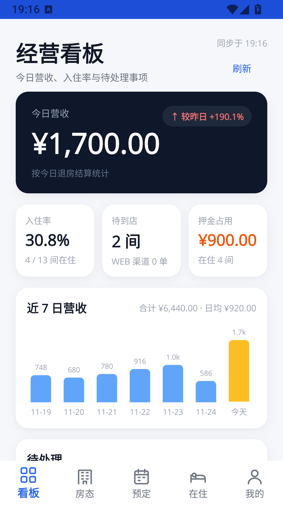
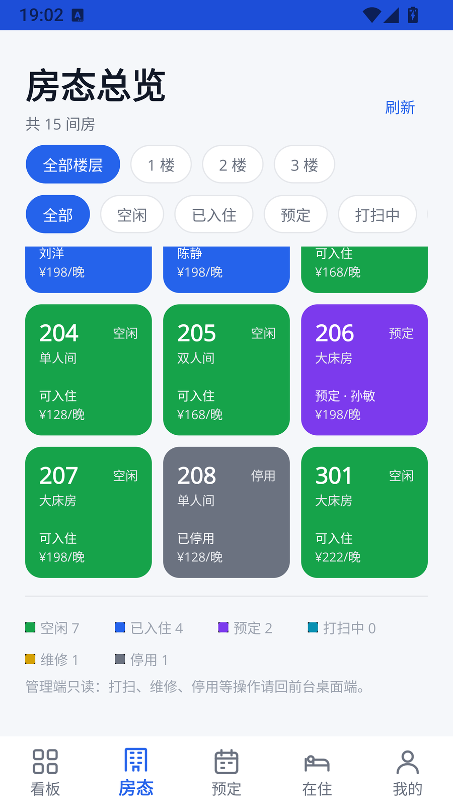
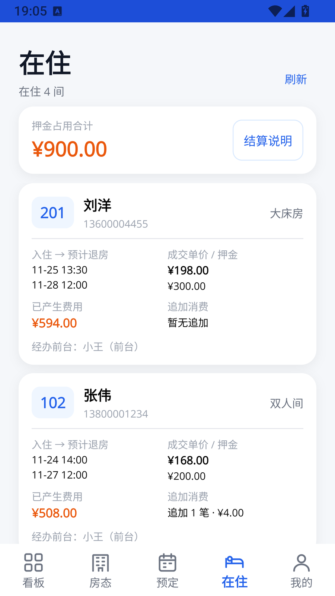
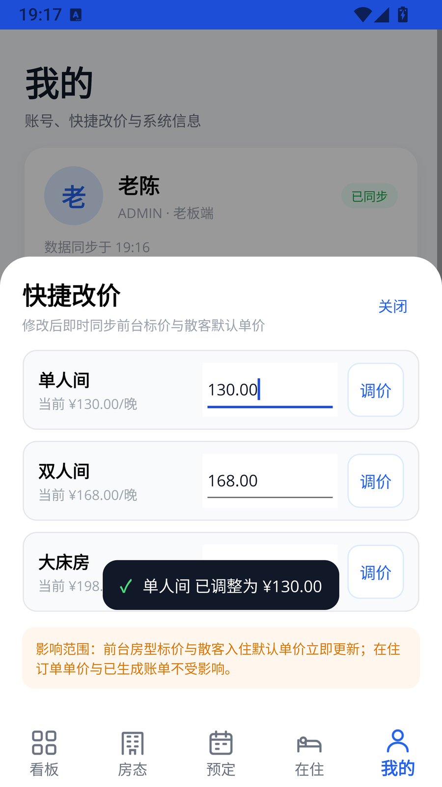

# HospiKeeper.App · Android 管理端

面向老板 / 管理员的 Android 管理端，使用 **.NET MAUI 10 原生 XAML**（不使用 Blazor Hybrid），只通过 `HospiKeeper.Client` 访问 API。仅 ADMIN 账号可登录。

| 经营看板 | 房态总览 |
| --- | --- |
|  |  |

| 在住 | 快捷改价 |
| --- | --- |
|  |  |

## 能力

- **看板**：今日营收与昨日涨跌、入住率、待到店、押金占用、近 7 日营收、待处理事项。
- **房态**：只读，楼层 / 房态筛选、三列房态色卡、图例、房间详情底部抽屉。
- **预定**：待到店 / 已转入住 / 已取消筛选，WEB / 前台渠道标识，详情与取消预定。
- **在住**：只读列表、押金合计、结算说明。
- **我的**：个人信息、快捷改价、操作日志、关于、退出登录。

App 内的写操作只有两个：**取消预定** 与 **快捷改价**。入住、退房、收款、押金、证件、房态操作、房间 / 房型 / 账号管理均不提供。

## 技术结构

```text
App → HospiKeeper.Client → Contracts → Domain
```

- `AppShell`：底部 5 个 Tab（看板 / 房态 / 预定 / 在住 / 我的）。
- `MauiProgram`：注册 `ApiProvider`、`AppSession`、`ToastService`、页面与 ViewModel。
- `ApiProvider`：持有 API 客户端，登录页可修改服务器地址并持久化到 `Preferences`。
- `ToastHost`：页面底部轻提示，`ZIndex` 高于底部抽屉，改价成功提示不会被遮挡。
- 页面列表统一使用 `ScrollView + BindableLayout`；房态三列网格由 `Controls/RoomCardView` 复用。
- 品牌色 `#2563EB`，图标 / 启动页使用与 Web favicon 一致的“栖”图标。

## 构建与安装

```bash
dotnet build src/HospiKeeper.App/HospiKeeper.App.csproj -f net10.0-android

dotnet publish src/HospiKeeper.App/HospiKeeper.App.csproj -f net10.0-android -c Release \
  -p:AndroidKeyStore=false -p:AndroidPackageFormat=apk

adb install -r src/HospiKeeper.App/bin/Release/net10.0-android/publish/com.sylvie233.hospikeeper-Signed.apk
```

要求 Android SDK 24+ 与对应 MAUI workload。包名 `com.sylvie233.hospikeeper`。

## API 地址

- 默认：`http://10.0.2.2:5080`（标准 Android 模拟器访问宿主机）。
- LDPlayer 等桥接网络：在登录页点击「服务器 / 修改」，填写电脑的宿主机网关或局域网 IP。
- 当前开发机雷电模拟器使用 `http://172.16.1.2:5080`。
- 本地调试允许 cleartext HTTP（`AndroidManifest.xml` 的 `usesCleartextTraffic`）；生产环境应改为 HTTPS。

## 快捷改价

调用 `PUT /api/room-types/{id}`。`RoomService.UpdateRoomTypeAsync` 在价格变化时同步所有同房型房间的 `Price`，并写入「改价」日志；修改当前房间类型的基础定价会影响前台标价与散客默认单价，但不改已生成账单和在住订单单价。
