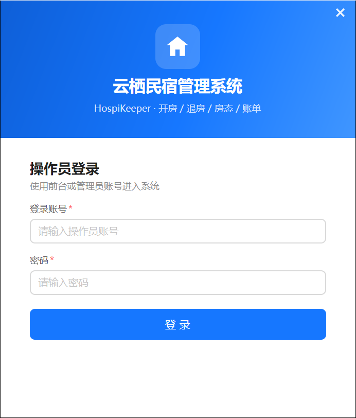
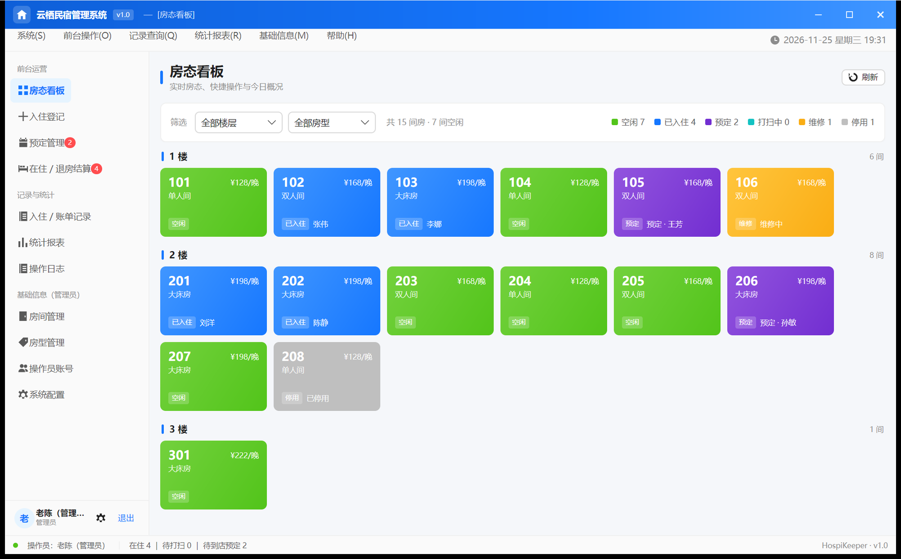

# HospiKeeper.Desktop · Avalonia 桌面端

面向民宿前台 / 管理员的桌面经营客户端，覆盖柜台业务的完整闭环。界面基于自研 [Sylvie233.UI](../Sylvie233.UI/README.md) Ant 风格控件库，MVVM 使用 CommunityToolkit.Mvvm。

| 登录 | 房态看板 |
| --- | --- |
|  |  |

## 功能

- **房态看板**：六种房态、楼层 / 房型筛选、房态图例、快捷入住 / 退房 / 打扫 / 维修入口。
- **入住登记**：议价、押金、同住人、预计退房、费用试算；左侧表单独立滚动，右侧报价固定。
- **预定管理**：创建、转入住、取消；预定房间状态联动。
- **在住与退房**：追加消费、损坏扣费、加钟、押金抵扣、结算单。
- **记录与报表**：入住 / 账单记录、操作日志、今日指标、近 7 日营收、区间营收与房型分析。
- **基础信息**：房间、房型、操作员账号、系统配置（管理员）。
- **系统配置**：动态调整游客 Web 与桌面端品牌、首页文案、联系方式、页脚与入住须知。

## 运行

先启动 API（默认 `http://localhost:5080`），再执行：

```bash
dotnet run --project src/HospiKeeper.Desktop
```

或使用根目录脚本同时启动 MySQL / API 并打开桌面端：

```powershell
pwsh ./manage.ps1 dev
```

API 地址配置在 `appsettings.json`：

```json
{
  "Api": {
    "BaseUrl": "http://localhost:5080"
  }
}
```

可用环境变量 `HOSPITKEEPER_API_URL` 覆盖。

## 架构

```text
Desktop → HospiKeeper.Client → Contracts → Domain
Desktop → Sylvie233.UI / Sylvie233.Logging
```

- 页面 View 只绑定 ViewModel，业务调用经 `IHospiKeeperApi`，不直接访问数据库。
- 弹窗由 `DialogService` 管理；提示走 `ToastService`。
- `GlobalUsings.cs` 把契约 DTO 映射为桌面端旧类型别名；不要新增 `using HospiKeeper.Domain.Entities;`。
- 表格统一使用 `AntTable`，默认每页 10 条，`PageSize=0` 可关闭分页。
- 页面使用 `AntPageHeader` + `AntCard` + `AntTable`，主色 `#1677FF`。

## 业务边界

- 入住、退房、收款、押金、证件登记、房态与房间管理只在桌面端完成。
- 房型改名同步所有房间冗余 `TypeName`；改价同步所有同房型房间的 `Price` 并写入「改价」日志。
- 有在住 / 预定 / 历史单据的房间禁止删除，可改为停用。
- 不能停用 / 删除当前登录账号；至少保留一名启用管理员。

更完整的接口、计费与权限规则见 [API README](../HospiKeeper.Api/README.md) 与 [CLAUDE.md](../../CLAUDE.md)。

## 图标

桌面 EXE 与窗口使用与 Web favicon 一致的品牌图标：

- `Assets/app.ico`：Windows 可执行文件图标；
- `Assets/app.png`：Avalonia 窗口图标。

替换图标后重新 `dotnet build` 即可生效。
