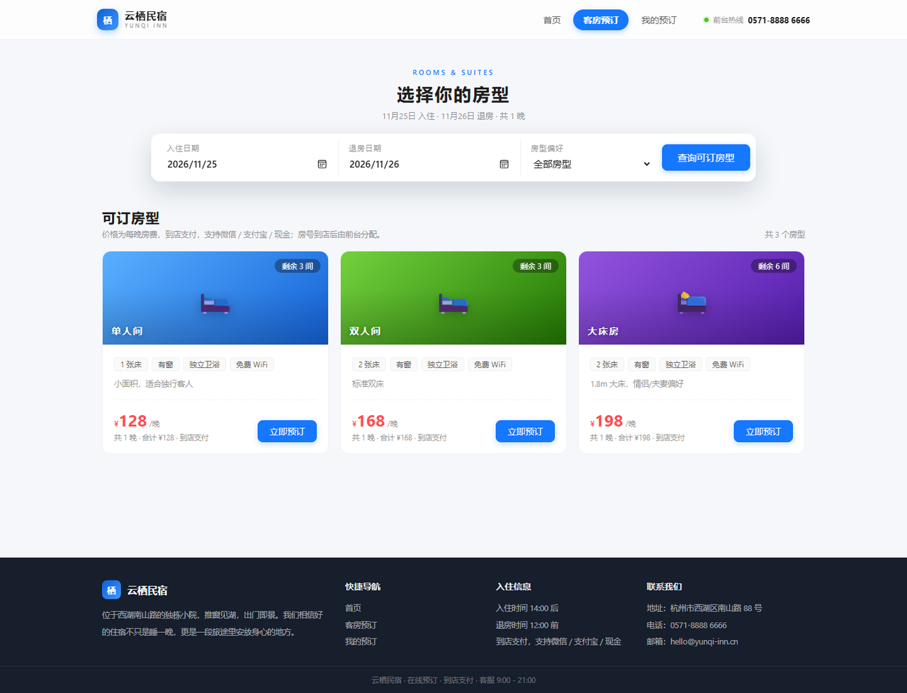

# HospiKeeper.Web · 游客预订门户

面向游客的在线预订 Web，使用 **Blazor Web App + Interactive Server SSR**。只通过 `HospiKeeper.Client` 调用 API，不引用 EF Core / MySQL。

| 首页 | 客房预订 |
| --- | --- |
|  |  |

## 页面

| 路由 | 说明 |
| --- | --- |
| `/` | 品牌首页、日期查询、精选房型、特色与入住须知 |
| `/rooms` | 房型实时可订量、日期筛选、在线预订弹窗 |
| `/mine` | 手机号查询我的预订、在线取消 |

静态文案（品牌、Hero、联系方式、页脚、特色、须知）全部来自 `GET /api/public/settings`，可在桌面端「基础信息 → 系统配置」修改，不在 Razor 中硬编码。

## 预订模型

- 只锁 **房型 + 日期段**，不锁具体房间。
- 到店由前台在桌面端「转入住」选择该房型空闲房，并回填 `room_id`。
- 可售量 = 房型可售房数 − 日期段重叠的待到店预订数。
- 提交时在服务端事务内二次校验库存；取消后库存自动回补。
- 游客端不改变任何 `room.status`。

## 公开 API

| 方法 | 路径 | 说明 |
| --- | --- | --- |
| GET | `/api/public/summary` | 首页统计 |
| GET | `/api/public/room-types?checkIn=&checkOut=` | 房型实时可订量 |
| POST | `/api/public/reservations` | 提交预订 |
| GET | `/api/public/reservations?phone=` | 手机号查询 |
| POST | `/api/public/reservations/{resNo}/cancel` | 游客取消 |
| GET | `/api/public/settings` | 游客 Web 静态配置 |

公开接口在 `ApiAuthMiddleware.IsPublic` 中免鉴权，并在 OpenAPI 中取消 Bearer 要求。

## 运行

先启动 API，再执行：

```bash
dotnet run --project src/HospiKeeper.Web
```

默认地址 <http://localhost:5081>。API 地址配置在 `appsettings.json` 的 `Api:BaseUrl`，默认 `http://localhost:5080`。

也可以直接使用容器：

```powershell
pwsh ./manage.ps1 image:build -Target web
pwsh ./manage.ps1 image:up
```

容器内通过 `Api__BaseUrl=http://api:8080` 访问 API，宿主机端口 `5081`。

## 数据库说明

游客预订 v1.1 为 `reservation` 增加了房型、日期段、渠道等字段。按项目约定，这些字段直接维护在 `Docs/民宿管理系统-数据库设计-v1.sql`，不使用 dotnet-ef 生成迁移；API 启动时由 `ReservationSchemaUpgrader` 幂等补列并回填旧数据。

## 日志与配置

- 日志：`Sylvie233.Logging`，文件 `logs/web-*.log`，配置项与 API 相同。
- 新增页面：引用 `Contracts` + `Client`，不要新增数据库访问；新增公开 API 时同步 `PublicBookingController`、鉴权白名单与 OpenAPI 公开路径。
